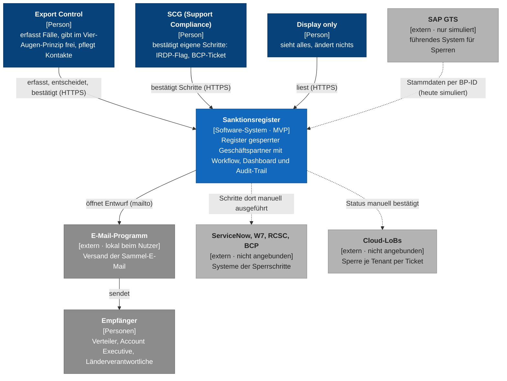
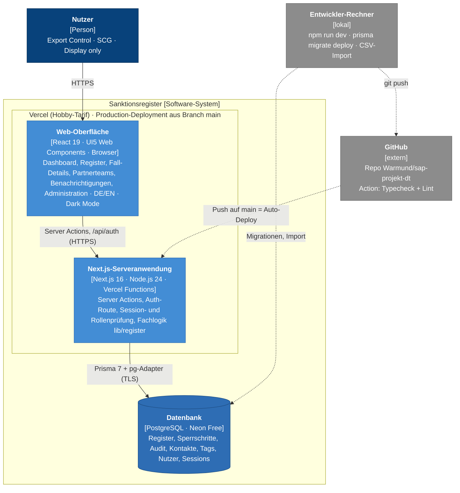
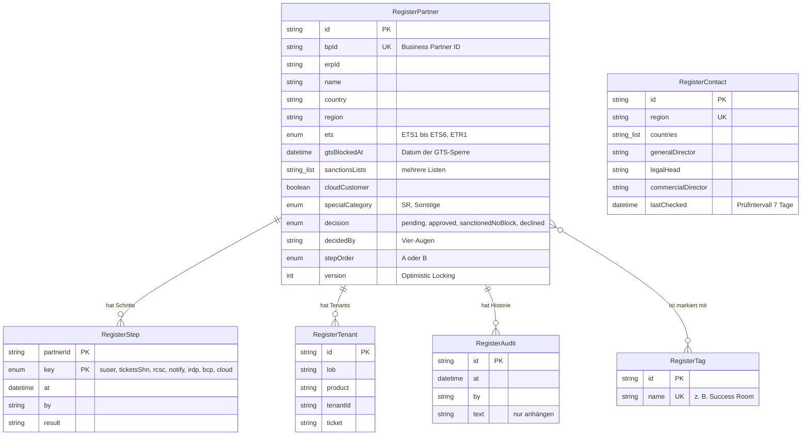
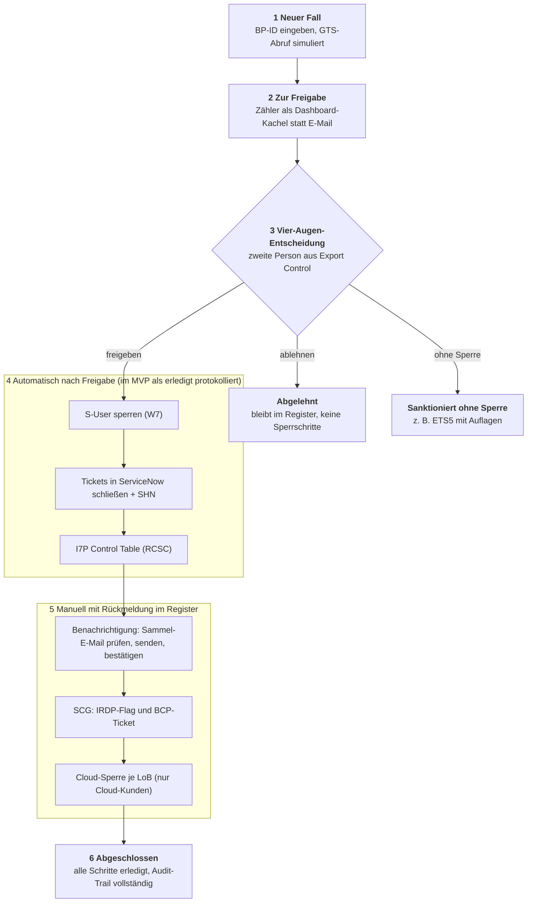

# Architekturdokument Sanktionsregister

Projekt G · Workflow und Datenbank für sanktionierte Geschäftspartner

| | |
|---|---|
| **Projekt** | G, Workflow und Datenbank für sanktionierte Geschäftspartner |
| **Praxispartner** | SAP SE, Export Control |
| **Version** | 1.0, Stand 25.11.2026 |
| **Status** | Vorlage zum Reviewboard am 04.12.2026 |
| **Code-Stand** | `Warmund/sap-projekt-dt`, Branch `main`, Commit `d6c72ca` (20.11.2026) |
| **Demo** | <https://project-dt-sap.vercel.app> (Anmeldung erforderlich) |
| **Form** | C4-Modell (Kontext- und Containersicht), ergänzt um Datenmodell, Ablauf, Sicherheit und Betrieb |

> Diese Markdown-Fassung ist inhaltlich identisch mit der Word-Datei `Architekturdokument_Projekt_G_v1.0.docx`. Die Diagramme sind hier als Mermaid hinterlegt und werden von GitHub direkt angezeigt.

## 1 Zweck und Einordnung

Dieses Dokument beschreibt, wie der Prototyp des Sanktionsregisters technisch aufgebaut ist. Die fachlichen Anforderungen stehen in der Project Charter, im Backlog und in den Besprechungsprotokollen mit SAP.

Der Prototyp ist ein **eigenständiges MVP außerhalb der SAP-Landschaft**. Er arbeitet ausschließlich mit synthetischen Testdaten und ist nicht an SAP-Systeme angebunden. Daten, die später aus SAP GTS oder anderen Systemen kämen, werden simuliert oder manuell gepflegt. Ziel ist eine vorführbare Lösung, die SAP Export Control als konkrete Anforderungsgrundlage für die SAP-IT nutzen kann.

## 2 Ziele und Rahmenbedingungen

**Architekturziele**

| Ziel | Bedeutung für die Architektur |
|---|---|
| Selbst ausprobierbar | Läuft im Internet, Zugang nur mit Benutzername und Passwort, ohne Vercel- oder GitHub-Konto |
| Nachvollziehbar | Jede Entscheidung und jeder Sperrschritt wird mit Zeitpunkt und Person im Audit-Trail festgehalten |
| Mehrbenutzerfähig | Mehrere SAP-Mitarbeitende arbeiten gleichzeitig, ohne sich gegenseitig zu überschreiben |
| Schnell änderbar | Anforderungen aus den SAP-Terminen lassen sich innerhalb von Stunden umsetzen und ausrollen |
| Übergabefähig | Fachlogik ist von der Oberfläche getrennt, damit SAP-IT sie nachvollziehen und übertragen kann |
| Kostenfrei im Projekt | Nur kostenlose Tarife und Open-Source-Komponenten |

**Rahmenbedingungen**

- Kein Zugriff auf SAP-Systeme (GTS, ServiceNow, CRM, Cloud-Systeme) im Projektzeitraum.
- Nur synthetische Daten, keine echten Kundendaten. Die Original-CSV liegt nicht im öffentlichen Repository.
- Keine technischen Vorgaben von SAP. Der Vorschlag des Teams wurde von SAP bestätigt (Coaching-Protokoll vom 23.11.2026).
- Kleines studentisches Team, daher möglichst wenige Dienste und kein eigener Serverbetrieb.

## 3 Kontextsicht (C4 Ebene 1)

*Kontextsicht: Nutzer und Nachbarsysteme des Sanktionsregisters*

| Beteiligte | Rolle gegenüber dem System |
|---|---|
| Export Control | Erfasst Fälle per Business Partner ID, entscheidet im Vier-Augen-Prinzip, bestätigt Schritte, pflegt Kontakte und Tags |
| SCG (Support Compliance Group) | Bestätigt die eigenen Schritte IRDP-Flag und BCP-Ticket, sieht alles andere nur lesend |
| Display only | Sieht Dashboard, Register und Fälle, ändert nichts |
| E-Mail-Programm des Nutzers | Öffnet die vorbereitete Sammel-E-Mail. Das System versendet selbst keine E-Mails |
| Empfänger | Fester Verteiler, Account Executive und Länderverantwortliche je Kunde |
| SAP GTS | Führendes System für Sperren. Im MVP wird der Abruf per BP-ID simuliert |
| ServiceNow, W7, RCSC, BCP, Cloud-LoBs | Systeme, in denen die Sperren tatsächlich ausgeführt werden. Im MVP nicht angebunden; das Register hält nur den Status fest |

Gestrichelte Linien im Diagramm sind Verbindungen, die es im MVP technisch nicht gibt.

## 4 Containersicht (C4 Ebene 2)

*Containersicht: Bausteine, Technologien und Verbindungen*

| Container | Technologie | Aufgabe |
|---|---|---|
| Web-Oberfläche | React 19, UI5 Web Components for React 2.28 (SAP Fiori), läuft im Browser | Dashboard, Register mit Suche, Filtern und Sortierung, Fall-Details mit Reitern für Sperrschritte und Stammdaten, Partnerteams, Benachrichtigungen, Kontakte, Administration. Deutsch und Englisch, Dark Mode |
| Next.js-Serveranwendung | Next.js 16 (App Router, TypeScript), Node.js 24, als Vercel Functions | Rendert die Seiten, nimmt Änderungen über Server Actions entgegen, stellt die Anmelde-Route `/api/auth` bereit, prüft Session und Rolle vor jedem Datenzugriff |
| Datenbank | PostgreSQL bei Neon (kostenloser Tarif), Zugriff über Prisma 7 mit `@prisma/adapter-pg` | Speichert Register, Sperrschritte, Audit-Trail, Tenants, Kontakte und Tags sowie Nutzer, Sessions und Rate-Limit der Anmeldung |

**Bewusst nicht vorhanden:** kein separates Backend, keine Workflow-Engine, kein Message Broker, kein Mailserver, keine Hintergrundjobs. Der Workflow ist reine Fachlogik im Code und wird bei jeder Aktion synchron ausgewertet. Für den Umfang des MVP reicht das und hält Betrieb und Kosten bei null.

## 5 Aufbau der Anwendung

| Bereich im Code | Inhalt |
|---|---|
| `app/` | Seitenrahmen (`layout.tsx`, `shell.tsx`), Login, Einstellungen, Benutzerverwaltung |
| `app/_register/` | Oberfläche des Registers: `dashboard`, `register-list`, `detail`, `new-entry`, `tasks` (Partnerteams), `notifications`, `contacts`, `tags`, Excel-Export; `actions.ts` als einzige Server Action für Änderungen |
| `lib/register/` | Fachlogik ohne React: Typen, Workflow-Regeln (`workflow.ts`), Datenbankzugriff und Validierung (`repository.ts`), Mock-Daten |
| `lib/auth.ts`, `lib/roles.ts` | Anmeldung mit Better Auth, Rollen und Berechtigungsprüfung |
| `prisma/` | Datenbankschema und 7 versionierte Migrationen |
| `scripts/` | CSV-Import der Testkunden, Anlegen von Demo-Nutzern |
| `tests/`, `lib/register/*.test.ts` | Playwright-Oberflächentests und Logiktests für den Workflow |

Die Trennung von `lib/register` und `app/_register` ist gewollt: Die Regeln, wann welcher Schritt läuft, wartet oder erledigt ist, hängen nicht an der Oberfläche. Eine spätere Umsetzung bei SAP kann sie als Spezifikation lesen oder übernehmen.

## 6 Datenmodell

*Datenmodell: Tabellen und Beziehungen*

- **RegisterPartner** ist der zentrale Datensatz je gesperrtem Geschäftspartner, mit BP-ID und ERP-ID, Land und Region, ETS-Kategorie, Datum der GTS-Sperre, Sanktionslisten (mehrere möglich), Cloud-Kennzeichen, Sonderkennzeichen und der Vier-Augen-Entscheidung.
- **RegisterStep** hält je Fall und Schritt fest, wann wer was zurückgemeldet hat. Nicht erledigte Schritte haben keinen Eintrag; ihr Status wird aus den Workflow-Regeln berechnet.
- **RegisterAudit** ist die Historie. Einträge werden nur angehängt, nie geändert.
- **RegisterTenant** beschreibt die Cloud-Tenants eines Kunden je Line of Business.
- **RegisterTag** ersetzt die frühere Sonderkategorie, z. B. für Success-Room-Kunden (Protokoll 20.11.2026).
- **RegisterContact** enthält die Länderverantwortlichen je Region mit Prüfdatum (Prüfintervall 7 Tage).
- Das Feld **version** dient dem Optimistic Locking: Eine Änderung wird nur gespeichert, wenn der Datensatz seit dem Laden nicht von jemand anderem geändert wurde. Sonst erscheint der Hinweis „Datensatz wurde inzwischen geändert. Bitte neu laden.“

## 7 Ablauf eines Falls (Laufzeitsicht)

*Ablauf eines Falls vom Eintrag bis zum Abschluss*

1. Export Control gibt nur die Business Partner ID ein. Die übrigen Stammdaten kommen aus dem simulierten GTS-Abruf und sind nicht editierbar; Sanktionslisten lassen sich vor dem Anlegen korrigieren.
2. Der Fall erscheint im Dashboard unter „Zur Freigabe“.
3. Eine zweite Person aus Export Control entscheidet: **freigeben**, **sanktioniert ohne Sperre** oder **ablehnen**. Abgelehnte und nicht gesperrte Fälle bleiben im Register sichtbar.
4. Nach der Freigabe werden S-User-Sperre, Ticket-Schließung in ServiceNow mit Special Handling und der Eintrag in der I7P Control Table automatisch als erledigt protokolliert. Im echten Betrieb wären das Schnittstellen; im MVP ist es eine Simulation.
5. Die übrigen Schritte werden manuell bestätigt: die tägliche Sammel-E-Mail unter „Benachrichtigungen“, die SCG-Schritte IRDP-Flag und BCP-Ticket durch die Rolle SCG, die Cloud-Sperre je LoB durch Export Control.
6. Sind alle Schritte erledigt, ist der Fall abgeschlossen. Jede Aktion steht im Audit-Trail.

## 8 Sicherheit und Berechtigungen

| Thema | Umsetzung im MVP |
|---|---|
| Anmeldung | Better Auth mit Benutzername und Passwort (mindestens 8 Zeichen); Nutzer legt Export Control in der Administration an, Selbstregistrierung ist abgeschaltet |
| Schutz vor Ausprobieren von Passwörtern | Rate-Limit auf die Anmeldung: höchstens 5 Versuche pro Minute, in der Datenbank gezählt |
| Rollen | `export-control` (alles bearbeiten), `scg` (nur IRDP- und BCP-Schritte bestätigen), `display-only` (nur lesen) |
| Prüfung | Serverseitig in der Server Action vor jedem Schreibzugriff; die Oberfläche blendet zusätzlich nicht erlaubte Aktionen aus |
| Datenzugriff | Nur der Server-Teil verbindet sich mit der Datenbank; der Browser sieht keine Zugangsdaten |
| Geheimnisse | Datenbank-URL und Auth-Secret als Umgebungsvariablen in Vercel bzw. lokal, nicht im Repository |
| Daten | Ausschließlich synthetische Testdaten |
| Nicht umgesetzt | SSO (in der Login-Maske als „noch nicht verfügbar“ markiert), Verschlüsselung über TLS hinaus, formale Security-Freigabe |

## 9 Deployment und Betrieb

| Thema | Umsetzung |
|---|---|
| Hosting | Vercel im Hobby-Tarif, Projekt `project-dt-sap` |
| Auslieferung | Vercel-Git-Integration: Push auf `main` erzeugt das Production-Deployment, andere Branches ein Preview-Deployment |
| Qualitätssicherung | GitHub Action `typecheck.yml` (Typecheck und Lint) bei jedem Push; Tests lokal mit Playwright und Node-Testrunner |
| Datenbank | Neon, kostenloser Tarif; eine gemeinsame Datenbank für Entwicklung und Demo |
| Migrationen | Versioniert mit Prisma; werden gezielt mit `prisma migrate deploy` gegen die Datenbank ausgeführt, nicht automatisch beim Build |
| Testdaten | 50 synthetische Kunden per CSV-Import (`npm run import:customers`) |
| Monitoring | Vercel Analytics und Speed Insights; kein eigenes Monitoring oder Alerting |
| Backups | Nur, was der Neon-Tarif mitbringt; kein eigenes Backup-Konzept |

## 10 Schnittstellen

| Richtung | MVP | Zielbild bei SAP |
|---|---|---|
| Eingang Stammdaten | Simulierter GTS-Abruf per BP-ID, CSV-Import | Automatische Übernahme gesperrter Partner aus SAP GTS |
| Ausgang Benachrichtigung | E-Mail-Entwurf über `mailto:` im eigenen Mailprogramm, Versand manuell bestätigt | Versand über SAP-Mailinfrastruktur, Empfänger aus einem SAP-System |
| Ausgang Sperrschritte | Status wird im Register bestätigt | ServiceNow, W7 (S-User), RCSC, BCP und Cloud-LoBs per API oder Ticket |
| Ausgang Berichte | Excel-Export der Stammdaten | Zusätzlich Auswertungen für Controlling und Behörden |
| Anmeldung | Benutzername und Passwort | SSO über SAP Identity (OIDC) |

## 11 Architekturentscheidungen

| # | Entscheidung | Begründung | Alternative |
|---|---|---|---|
| E1 | Eine Fullstack-Anwendung mit Next.js statt Frontend plus eigenem Backend | Ein Projekt, gemeinsame Typen, kein CORS, weniger Dienste | React-Frontend plus separate API |
| E2 | UI5 Web Components for React | Fiori-Optik, die SAP-Nutzer kennen; offenes SAP Design System | Eigenes Design, Material UI |
| E3 | PostgreSQL bei Neon mit Prisma | Relationale Daten mit Historie, kostenloser Tarif, typisierter Zugriff, versionierte Migrationen | SQLite, Supabase, Firebase |
| E4 | Vercel als Hosting | Automatisches Deployment aus GitHub, kein Serverbetrieb, kostenlos | Eigener Server, Render, Azure |
| E5 | Better Auth mit eigenen Zugängen | Demo ohne Vercel- oder SAP-Konto nutzbar; Rollen einfach abbildbar | Vercel Deployment Protection, Auth.js |
| E6 | Workflow als Code statt Workflow-Engine | Wenige feste Schritte, schnelle Änderungen in den SAP-Terminen | Camunda, SAP Build Process Automation |
| E7 | Optimistic Locking über eine Versionsnummer | Mehrere Nutzer gleichzeitig, ohne Sperren in der Datenbank | Keine Konfliktprüfung |
| E8 | Kein E-Mail-Versand durch das System | Kein Mailserver nötig; Mail wird vor dem Versand geprüft (Wunsch SAP, 20.11.2026) | SMTP-Dienst |

## 12 Risiken und offene Punkte

| Punkt | Auswirkung | Umgang |
|---|---|---|
| Eine Datenbank für Entwicklung und Demo | Fehler beim Entwickeln wirken sofort auf die Testphase bei SAP | Während der SAP-Testphase keine Schemaänderungen ohne Absprache; Trennung prüfen |
| Vercel-Hobby-Tarif ist nur für nicht kommerzielle Nutzung gedacht | Für einen Betrieb bei SAP nicht geeignet | Für den Prototyp unkritisch; bei Weiterbetrieb Pro-Tarif oder Übergabe an SAP-IT |
| Empfänger der Benachrichtigungen je Schritt noch offen | Benachrichtigungslogik kann sich ändern | Entscheidung SAP abwarten; Kontakte sind bereits als eigene Tabelle modelliert |
| Automatisierbarkeit der ServiceNow-Schritte offen | Schritt bleibt im MVP simuliert | Im Zielbild als Integrationspunkt beschrieben |
| Kein Backup- und Monitoring-Konzept | Datenverlust bei Fehlbedienung möglich | Nur synthetische Daten; CSV-Import kann den Stand wiederherstellen |
| Feedback aus der SAP-Testphase (bis ca. 04.12.2026) | Mögliche Scope-Erweiterung | Im Reviewboard besprechen, ins Backlog aufnehmen |

## 13 Ausblick: Zielarchitektur bei SAP

Für eine produktive Lösung bei SAP wären mindestens diese Punkte mit der SAP-IT zu klären:

- **Plattform:** Betrieb in der SAP-Umgebung, z. B. auf SAP BTP, statt auf Vercel und Neon.
- **GTS-Schnittstelle:** Automatische Übernahme gesperrter Partner, einschließlich Sanktionslisten und ETS-Kategorie.
- **Ausführung der Sperren:** Anbindung von W7, ServiceNow, RCSC und BCP, Ticket-Erstellung für die Cloud-LoBs, automatische Abfrage von Cloud-Status und Tenants.
- **Kontakte:** Account-Team aus einem SAP-System statt manueller Pflege.
- **Identität:** SSO und Rollen aus dem SAP-Identitätsdienst.
- **Compliance:** Security- und Datenschutzfreigabe, Aufbewahrung des Audit-Trails, Betriebsverantwortung.

Die Fachlogik in `lib/register` und das Datenmodell sind die Teile, die sich am direktesten als Spezifikation übernehmen lassen.

## Änderungshistorie

| Version | Datum | Änderung |
|---|---|---|
| 1.0 | 25.11.2026 | Erste Fassung für das Reviewboard am 04.12.2026 |

Weitere Quellen im Repository: [infrastructure.md](../infrastructure.md), [projektkonzept.md](../projektkonzept.md), [register-prototyp.md](../register-prototyp.md), [architektur-mvp.drawio](../architektur-mvp.drawio) (Planungsstand vom 29.10.2026).
