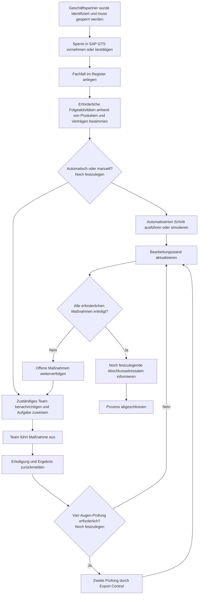

# Konsolidiertes Projektkonzept

**Projekt:** Workflow und Datenbank für sanktionierte Geschäftspartner

**Projektpartner:** SAP SE, Export Control

**Hochschule:** Frankfurt University of Applied Sciences

**Stand:** 27.10.2026

**Dokumentstatus:** Arbeitsstand und zentrale Informationsbasis

## 1. Zweck dieses Dokuments

Dieses Dokument konsolidiert die derzeit bekannten Projektinformationen aus der Projektbeschreibung, den drei Mitschriften des SAP-Kick-offs vom 23.10.2026, der Infrastrukturplanung, der Hosting-Recherche, der Project Charter und der anschließend von Jette übermittelten vorgeschlagenen Timeline. Es trennt bestätigte Festlegungen von Vorschlägen und offenen Punkten.

Ausführliche technische Anleitungen und Recherchebelege bleiben in ihren jeweiligen Quelldokumenten erhalten. Dieses Dokument fasst sie zusammen und verweist darauf, damit es als zentrale Projektübersicht genutzt werden kann.

## 2. Kurzfassung

SAP Export Control prüft Geschäftspartner gegen relevante Sanktionslisten. Muss eine Geschäftsbeziehung gesperrt werden, entstehen abhängig von Produkten, Verträgen und betroffenen Diensten mehrere Folgeaufgaben in unterschiedlichen Teams. Die Kommunikation erfolgt derzeit überwiegend per E-Mail; Informationen werden teilweise in mehreren Excel-Dateien gepflegt und nur unregelmäßig abgeglichen. Daraus entstehen Medienbrüche, unklare Zuständigkeiten, mangelnde Transparenz und Risiken für die Datenqualität.

Das Projekt soll einen demonstrierbaren Stand-alone-MVP entwickeln, der zwei Aspekte verbindet:

1. eine workflowartige Kommunikation mit Aufgaben, Benachrichtigungen, Rückmeldungen und einer transparenten Übersicht über offene und erledigte Schritte;
2. ein zentrales Register für sanktionierte Geschäftspartner mit Suche, Statusübersicht, Statistik und Dashboard.

Der MVP arbeitet ausschließlich mit synthetischen Mock-Daten. Eine echte Integration mit SAP GTS oder anderen SAP-Systemen wird nicht implementiert, aber als spätere Zielarchitektur im Solution Design betrachtet. Der technische Stack ist auf Next.js, UI5 Web Components for React, Prisma und PostgreSQL festgelegt. Für die Demo ist ein direktes Deployment auf Vercel mit externem PostgreSQL geplant.

## 3. Ausgangslage und fachlicher Kontext

SAP Export Control ist dafür verantwortlich, Geschäftspartner gegen relevante Sanktionslisten zu prüfen. Ein Treffer kann dazu führen, dass SAP bestehende Geschäftsbeziehungen abbrechen muss und beispielsweise keine neuen Verträge schließen, keine Software ausliefern oder bei sanktionierten Lieferanten nichts mehr bestellen darf.

SAP GTS ist das führende System für die eigentliche Kundensperre. Die daraus entstehenden Folgeaktivitäten werden heute jedoch weitgehend manuell koordiniert. Genannte Beispiele sind:

- Sperrung betroffener Cloud-Zugänge;
- Behandlung betroffener S-User beziehungsweise Zugänge zum SAP-Service-Portal;
- Information und Beauftragung zuständiger Fach- und Produktteams;
- Rückmeldung der ausgeführten Maßnahmen;
- Information des Account Executive, damit dieser gegenüber dem Kunden auskunftsfähig ist.

Welche Maßnahmen erforderlich sind, hängt insbesondere von Produkten und Verträgen des betroffenen Kunden ab. Die heute parallel geführten Excel-Dateien werden nur gelegentlich abgeglichen und sind laut Kick-off-Mitschriften nicht immer aktuell oder vollständig.

## 4. Zielbild und Nutzen

Das Zielbild ist eine gemeinsame, aktuelle Sicht auf sanktionierte Geschäftspartner und den Bearbeitungsstand aller ausgelösten Folgeaktivitäten. Das System soll:

- eine zentrale Datenbasis anstelle verteilter Excel-Listen demonstrieren;
- Zuständigkeiten, offene Aufgaben und erledigte Maßnahmen sichtbar machen;
- Kommunikations- und Workflowabläufe nachvollziehbar beschreiben;
- geeignete Schritte automatisieren und bei anderen Schritten einen Menschen einbeziehen;
- zuständige Teams benachrichtigen und Rückmeldungen erfassen;
- unterschiedliche Berechtigungsstufen unterstützen;
- eine benutzerfreundliche Suche und statistische Auswertungen anbieten;
- als Diskussions- und Entscheidungsgrundlage für eine spätere SAP-integrierte Lösung dienen.

Der erwartete Nutzen besteht vor allem in höherer Prozesstransparenz, klareren Verantwortlichkeiten, besserer Datenqualität und geringerem manuellen Koordinationsaufwand. Quantifizierte Nutzen- oder Kostenziele liegen noch nicht vor.

## 5. Scope

### 5.1 Inhalt des MVP

- Stand-alone-Webanwendung im SAP-nahen Fiori-Erscheinungsbild;
- Register beziehungsweise Datenbank für sanktionierte Geschäftspartner;
- Suche und Übersicht über Sperren;
- Darstellung und Bearbeitung von Folgeaufgaben;
- Rückmeldung erledigter Aktivitäten;
- Anzeige des Bearbeitungsstands;
- unterschiedliche Berechtigungsstufen, deren genaue Ausprägung noch festzulegen ist;
- simulierte und protokollierte Benachrichtigungen beziehungsweise In-App-Aufgaben;
- Statistik beziehungsweise Dashboard;
- synthetische Mock-Daten;
- Testfälle und dokumentierte Testergebnisse;
- technische Dokumentation und Endanwenderdokumentation.

Die vorhandenen Mitschriften konkretisieren vor allem den Kundenfall. Ob derselbe MVP-Prozess auch Lieferanten und andere Geschäftspartner abdecken soll, ist noch nicht entschieden. Bis zur Klärung wird der Kundenfall als Demonstrationsszenario verwendet, ohne den fachlichen Oberbegriff „Geschäftspartner“ einzuschränken.

### 5.2 Nicht im MVP

- produktive Anbindung an SAP GTS oder andere SAP-Systeme;
- Verwendung echter SAP-, Kunden-, Sanktions- oder personenbezogener Daten;
- echter E-Mail-Versand oder produktive Benachrichtigungsinfrastruktur;
- SAP BTP, Kubernetes oder eine Microservice-Architektur;
- Hochverfügbarkeit, Backups und Monitoring;
- produktive Freigabe oder Betrieb innerhalb der SAP-Systemlandschaft.

### 5.3 Spätere Zielarchitektur

Eine spätere produktive Lösung soll konzeptionell eine Schnittstelle zwischen SAP GTS und dem Register berücksichtigen. Dafür wären mindestens die technische API, Authentifizierung, Berechtigungen, Datenschutz, Sicherheitsfreigaben, Datenherkunft, Betriebsverantwortung und die Einbindung der zuständigen SAP-IT-Teams zu klären.

Für externe Systeme wurde im Kick-off als Einschränkung genannt, dass Informationen nicht nachvollziehbar auf SAP zurückzuführen sein dürfen; als mögliches Beispiel wurde die Prüfung erwähnt, ob eine Adresse existiert. Bedeutung und Reichweite dieser Aussage müssen von SAP präzisiert werden.

## 6. Prozessklärung und Processflow

Jettes vorgeschlagener Arbeitsplan setzt die gemeinsame Prozessklärung mit SAP an den Anfang. Zu beantworten sind dabei insbesondere:

- Welche Schritte laufen automatisch ab?
- Wer wird benachrichtigt?
- Wer muss manuell tätig werden?
- Wo ist ein Vier-Augen-Prinzip erforderlich?
- Wie werden erledigte Maßnahmen zurückgemeldet?
- Wer wird nach Abschluss informiert?

### 6.1 Konsolidierter Arbeitsentwurf

Der folgende Ablauf fasst Jettes Startpunkt und den in den Mitschriften beschriebenen Sollprozess zusammen. Automatisierung, konkrete Empfänger und Vier-Augen-Prüfungen sind noch mit SAP festzulegen.



Der MVP ersetzt die reale GTS-Aktion durch Mock-Daten beziehungsweise einen simulierten Eingang. Eine zweite Prüfung bei kritischen Schritten wird in einer Mitschrift als vorgesehen beschrieben, ist aber hinsichtlich Auslöser und Rolle noch nicht bestätigt.

## 7. Fachliche Anforderungen

### 7.1 Registerdaten

Die Mitschriften nennen mindestens folgende Informationen pro sanktioniertem Geschäftspartner beziehungsweise Fachfall:

- Customer ID und Name;
- ETS-, Restriktions- oder Blockierungskategorie;
- Referenz zur Sanktionsliste oder zum auslösenden Programm;
- Kennzeichnung eines besonderen Kundentyps oder einer speziellen Kategorie;
- Kommentar beziehungsweise Begründung;
- Sperrdatum und Sperrstatus;
- verantwortliche Person oder Organisationseinheit;
- Zuständigkeiten und Bearbeitungsstatus der Folgeaktivitäten;
- Zeitpunkt der Sperre und einer fachlichen Freigabe als Teil des Audit Trails;
- Land, falls dieses von Jette genannte Dashboard-Beispiel als Anforderung bestätigt wird.

Die Bedeutung der ETS-Kategorien und die dazu erwartete SAP-Guidance stehen noch aus.

### 7.2 Workflow und Kommunikation

- Folgeaktivitäten unterscheiden sich nach Produkten und Verträgen.
- Einige Aktivitäten sollen automatisiert, andere durch Menschen ausgeführt werden.
- Die Kommunikation selbst soll durch einen nachvollziehbaren Workflow unterstützt werden.
- Zuständige Teams erhalten Aufgaben beziehungsweise simulierte Benachrichtigungen.
- Teams melden ausgeführte Maßnahmen zurück.
- Offene und erledigte Schritte müssen transparent sichtbar sein.
- Account Executives sollen über den Status informiert und auskunftsfähig sein.
- Kritische Schritte können eine zweite Prüfung durch Export Control erfordern; die genaue Regel ist offen.

Ein echter Mailversand ist nicht vorgesehen. Beschlossen ist eine testbare Simulation, beispielsweise durch einen protokollierten Mock-Versand und eine sichtbare In-App-Aufgabe. Details der Ereignisse und Empfänger werden im Processflow festgelegt.

### 7.3 Suche und Dashboard

Die Anwendung soll eine benutzerfreundliche Suche und einen schnellen Überblick bieten. Jette nennt für das Dashboard insbesondere:

- Anzahl der im letzten Monat gesperrten Geschäftspartner;
- Verteilung nach Sperrgrund;
- Verteilung nach Land.

Weitere Kennzahlen und Filter sind noch nicht festgelegt. Als Deliverable genügt laut Vorschlag entweder ein Dashboard oder zumindest eine Ausgabe der relevanten Zahlen.

### 7.4 Rollen und Berechtigungen

Verschiedene Berechtigungsstufen sind gefordert. Die vollständigen Rollen, Rechte und Benutzergruppen sind noch nicht spezifiziert. Genannte fachliche Beteiligte sind Export Control, betroffene Fach- und Produktteams sowie Account Executives. Für die Demo sind individuelle App-Zugänge mit Benutzername und Passwort über Better Auth und eine SAP-nah gestaltete Login-Seite vorgesehen. Eine spätere SAP-Integration könnte OIDC beziehungsweise SSO erfordern.

## 8. Solution Design

### 8.1 Festgelegter Technologie-Stack

| Bereich | Festlegung |
| --- | --- |
| Anwendung | Next.js 16, App Router, TypeScript |
| Oberfläche | UI5 Web Components for React, SAP/Fiori-Design |
| Serverzugriff | Next.js Route Handlers und Server Actions |
| ORM | Prisma 7 |
| Datenbank | PostgreSQL 18 |
| Deployment | Vercel mit extern verwaltetem PostgreSQL |
| Paketmanager | npm mit Node.js 24 LTS |

Die ausführliche technische Planung steht in [infrastructure.md](infrastructure.md). Der Stack ist festgelegt; die dort beschriebenen Dateien und Komponenten sind zum Stand 27.10.2026 jedoch noch Planung und nicht im Repository implementiert.

### 8.2 Geplante Architektur

Das bearbeitbare Diagramm liegt unter [architektur-mvp.drawio](architektur-mvp.drawio). Durchgezogene Verbindungen zeigen den geplanten MVP; gestrichelte Verbindungen markieren mögliche spätere SAP-Integrationen außerhalb des MVP.

```text
Browser -> Next.js-Anwendung -> PostgreSQL
              |
              +-> simulierte Benachrichtigungen
              +-> Mock-Datenquelle als spätere GTS-Nahtstelle
```

Frontend und Backend bleiben für den MVP in einer Fullstack-Anwendung. Das reduziert die Zahl der Dienste, vermeidet eine separate API-Client- und CORS-Konfiguration und erlaubt gemeinsame Typen. Fachlogik soll von React und Next.js getrennt in `lib/` liegen, damit eine spätere Auslagerung möglich bleibt.

Geplant sind die Next.js-Anwendung auf Vercel und eine extern verwaltete PostgreSQL-Datenbank. Migrationen werden vor dem Deployment separat ausgeführt. Prisma-Migrationen und idempotente Seed-Daten sollen Datenbankschema und Mock-Daten reproduzierbar bereitstellen. Im MVP sind weder Broker noch separater Worker oder Mailserver vorgesehen.

### 8.3 Technische Konventionen

- UI5-Seiten werden als Client Components umgesetzt, um Hydration-Probleme mit Web Components zu vermeiden.
- Fachseiten mit aktuellen Daten sollen ohne veraltetes Cache-Ergebnis rendern.
- Berechtigungen werden serverseitig unmittelbar vor dem Datenzugriff geprüft.
- `proxy.ts` dient höchstens groben Session-Weiterleitungen, nicht der fachlichen Autorisierung.
- Workflowaktionen laufen im MVP direkt in der auslösenden Aktion; Hintergrundjobs sind nicht vorgesehen.
- Konfiguration und Secrets werden über Umgebungsvariablen bereitgestellt und nicht eingecheckt.
- Lokal läuft die App mit Hot Reload und derselben Datenbank wie die Demo.
- Die Demo wird direkt auf Vercel deployt; Entwicklung und Demo nutzen eine gemeinsame Datenbank. Schemaänderungen und Resets werden im Team abgestimmt.

### 8.4 Hosting und Demo-Umgebung

Die Demo soll direkt auf Vercel laufen; PostgreSQL wird bei Neon betrieben. Eine Datenbankressource im kostenlosen Tarif ist mit der Anwendung verbunden, und die Better-Auth-Migration wurde angewendet. Datenbankversion und vollständiger Zugriffsschutz sind noch zu prüfen. Die frühere [Hosting-Recherche](research/hosting-mvp-2026-10-25.md) dokumentiert den damaligen Vergleich; die Entscheidung für Vercel ersetzt ihre Empfehlung. Es werden ausschließlich synthetische Mock-Daten verwendet.

## 9. Deliverables und Timeline

Jette hat die folgende Timeline als Vorschlag und Anhaltspunkt übermittelt; sie ist ausdrücklich „nicht in Stein gemeißelt“. Die Jahreszahlen ergeben sich aus dem Projektstart im Oktober 2026. Das Projektende Ende Januar 2027 ist noch zu bestätigen.

| Arbeitspaket | Inhalt | Deliverable | Zielzeitraum |
| --- | --- | --- | --- |
| Prozessklärung | Automatische und manuelle Schritte, Benachrichtigungen, Vier-Augen-Prinzip, Rückmeldungen, Abschlussinformation gemeinsam mit SAP festlegen | Processflow-Diagramm | Mitte November 2026 |
| Solution Design | Tool, Entwicklungsumgebung, Stand-alone-Lösung und benötigte SAP-Anbindungen beschreiben | Solution-Design-Dokument und Product Backlog | Anfang Dezember 2026 |
| Implementierung | Workflow-Lösung und Datenbank entwickeln, testen und korrigieren | Code, Datenbank, Testfälle und Testergebnisse | Ende Januar 2027 |
| Statistik | Dashboard definieren, Kennzahlen ermitteln und darstellen | Dashboard oder Ausgabe relevanter Zahlen | Ende Januar 2027 |
| Dokumentation | Technische Dokumentation und Endanwenderdokumentation erstellen | Vollständige Dokumentation | Bis zum Projektabschluss, voraussichtlich Ende Januar 2027 |

Jette kündigte außerdem einen Detailaustausch im Donnerstags-Call und eine Präsentation am darauffolgenden Freitag an. Konkrete Kalenderdaten wurden in der vorliegenden Nachricht nicht genannt.

## 10. Vorläufiger Product Backlog

Der Product Backlog ist selbst ein Deliverable bis Anfang Dezember und muss nach der Prozessklärung verfeinert und priorisiert werden. Aus den vorhandenen Quellen ergeben sich derzeit folgende übergeordnete Einträge:

| Backlog-Thema | Erwartetes Ergebnis | Status |
| --- | --- | --- |
| Processflow | Abgestimmter Ablauf mit Rollen, Automatisierung, Rückmeldung und Freigaben | In Klärung |
| Entwicklungsgrundlage | Next.js-/UI5-/Prisma-/PostgreSQL-Projekt und reproduzierbarer Start | Beschlossen, noch nicht implementiert |
| Datenmodell und Seed | Schema, Migrationen und synthetische Mock-Daten | Geplant |
| Geschäftspartnerregister | Übersicht, Detailansicht und Statusinformationen | Geplant |
| Workflowaufgaben | Zuweisung, Bearbeitung und Rückmeldung von Folgeaktivitäten | Geplant |
| Benachrichtigungssimulation | Protokollierter Mock-Versand und sichtbare In-App-Aufgaben | Beschlossen, noch nicht implementiert |
| Rollen und Rechte | Zugriff entsprechend noch festzulegender Berechtigungsstufen | Fachlich offen |
| Suche | Benutzerfreundliche Suche nach Geschäftspartnern und Fällen | Geplant |
| Statistik/Dashboard | Noch abzustimmende Kennzahlen; Beispiele sind Zeitraum, Grund und Land | Geplant |
| Tests | Testfälle, Durchführung, Korrekturen und Ergebnisdokumentation | Geplant |
| Dokumentation | Technische und Endanwenderdokumentation | Geplant |

Es existieren aktuell noch keine GitHub-Issues, die in diesem Dokument als bestätigter Product Backlog ausgewertet wurden. Issues werden gemäß Repository-Konvention im GitHub-Repository `patrick-pag/sap-projekt-dt` geführt.

## 11. Test und Qualitätssicherung

Jettes Zeitplan fordert Testfälle und Testergebnisse. Ein konkretes Testkonzept, Testframework, Abnahmekriterien und Testdaten sind derzeit noch nicht festgelegt. Tests müssen mindestens die vereinbarten Workflowabläufe, Datenbankfunktionen, Suche, Berechtigungen und Dashboard-Berechnungen abdecken, sobald diese fachlich spezifiziert sind.

Zum Stand 27.10.2026 sind weder Anwendungscode noch automatisierte oder manuelle Testfälle vorhanden. Testergebnisse können deshalb erst im Verlauf der Implementierung ergänzt werden.

## 12. Dokumentation

Bis zum Projektabschluss sind zwei Zielgruppen abzudecken:

- **Technische Dokumentation:** Architektur, Entwicklungsumgebung, Datenmodell, Konfiguration, lokaler Start, Deployment, Migrationen, Testdurchführung und spätere Integrationspunkte.
- **Endanwenderdokumentation:** Anmeldung, Suche, Fallübersicht, Aufgabenbearbeitung, Rückmeldung, Dashboard und Bedeutung der sichtbaren Statusangaben.

Die vorhandene [infrastructure.md](infrastructure.md) bildet bereits einen technischen Entwurf. Dieses Projektkonzept ist die zentrale Gesamtübersicht; Detaildokumente bleiben ergänzende Quellen.

## 13. Stakeholder und Zusammenarbeit

### 13.1 Bekannte Beteiligte

- SAP SE, Export Control als Projektpartner und fachlicher Nutznießer;
- SAP-Kontakte: Jette Bork-W., Tobias Bahr und Nina S. Hahn;
- Export-Control-Mitarbeitende als initiierende und kontrollierende Fachrolle;
- betroffene Fach-, Produkt-, Cloud- und S-User-/Service-Portal-Teams;
- Account Executives als Ansprechpartner der Kunden;
- Data Quality; in einer Mitschrift wird Natascha genannt, die genaue Rolle ist offen;
- SAP-GTS-, IT-, Integrations-, Security- und Datenschutzverantwortliche für eine spätere Produktivlösung;
- Projektteam der Frankfurt University of Applied Sciences.

Eine Mitschrift nennt Lisa und Max als Projektmitarbeitende. Die vollständige Teamzusammensetzung und konkrete Rollenverteilung sind noch nicht bestätigt.

### 13.2 Governance und Kommunikation

- Präsenztermin bei SAP jeden zweiten Freitag;
- in den dazwischenliegenden Wochen ein Online-Termin;
- Abschlusspräsentation bei SAP mit Feedbackrunde;
- fachliche Abstimmung des Processflows gemeinsam mit SAP;
- offene oder geänderte Entscheidungen werden im Entscheidungslog festgehalten.

Projekt-Sponsor, Project Owner, Projektleitung, Freigabegremium und verbindliche Abnahmerollen sind noch nicht benannt.

## 14. Annahmen und Randbedingungen

- Der MVP ist ein schneller, demonstrierbarer Prototyp und keine produktive SAP-Lösung.
- Die Daten sind synthetisch; reale SAP-Daten sind nicht freigegeben.
- SAP GTS bleibt in einer späteren Zielarchitektur das führende System für Sperren.
- Der festgelegte technische Stack bleibt Next.js, UI5 Web Components, Prisma und PostgreSQL.
- Datenbankversion, genaue Rollen, Verwaltung der Demo-Zugänge und CI sind noch offen.
- Die vorgeschlagene Timeline ist eine Planungsbaseline und kein bestätigter harter Terminplan.
- Anforderungen, die weder aus Jettes Nachricht noch aus den bestehenden Dokumenten hervorgehen, werden nicht erfunden, sondern als offen behandelt.

## 15. Risiken

| Risiko | Mögliche Auswirkung |
| --- | --- |
| Unvollständig geklärter Processflow | Falscher oder lückenhafter Workflow im MVP |
| Noch unbekannte Teams und Empfänger | Aufgaben oder Informationen erreichen nicht alle Beteiligten |
| Ungeklärte ETS-Kategorien und Berechtigungen | Datenmodell und Zugriffsschutz können nicht verlässlich umgesetzt werden |
| Verwechslung von MVP und Zielarchitektur | Erwartung einer echten GTS-Integration trotz Mock-Scope |
| Verteilte und inkonsistente Ausgangsdaten | Unklare fachliche Regeln und schlechte Datenqualität |
| Ungeklärte Aussage zur Nutzung SAP-stämmiger Informationen in externen Systemen | Datenschutz-, Vertraulichkeits- oder Freigaberisiko |
| Offene Demo-/Hosting-Entscheidung | Späte technische Anpassungen oder ungeplante Kosten |
| Ambitionierte Umsetzung bis Ende Januar | Zeitrisiko für Implementierung, Test und Dokumentation |
| Derzeit ausschließlich dokumentarischer Repository-Stand | Sämtliche Software-, Datenbank-, Deployment- und Testartefakte müssen noch erstellt werden |

## 16. Offene Punkte

1. Gilt die Exportkontrollpflicht auch für registrierte Kunden ohne aktuelle Transaktion?
2. Deckt der MVP nur Kunden oder auch Lieferanten und andere Geschäftspartner ab?
3. Welche Schritte werden automatisiert, welche bleiben manuell?
4. Wo ist das Vier-Augen-Prinzip erforderlich und wer darf die zweite Prüfung durchführen?
5. Welche Teams, Kontaktpersonen und Empfängergruppen sind vollständig einzubeziehen?
6. Welche ETS- beziehungsweise Blockierungskategorien gibt es und was bedeuten sie?
7. Welche Rollen und konkreten Berechtigungen werden benötigt?
8. Welche Pflichtfelder, Statuswerte und fachlichen Validierungen gelten?
9. Wie genau erfolgt die Rückmeldung erledigter Maßnahmen?
10. Wer wird zu welchem Zeitpunkt abschließend informiert?
11. Welche SAP-GTS-API und weiteren SAP-Anbindungen wären für die Zielarchitektur erforderlich?
12. Wie ist die Aussage zur Nicht-Rückführbarkeit externer Abfragen konkret auszulegen?
13. Wird die Abschlussdemo lokal oder öffentlich gehostet?
14. Ist Ende Januar 2027 der bestätigte Projektabschluss?
15. Wer übernimmt Sponsor-, Owner-, Projektleitungs- und Abnahmerollen?
16. Welche Testfälle, Abnahmekriterien und Qualitätsgrenzen werden verbindlich?
17. Welche zusätzlichen Dashboard-Kennzahlen und Filter werden benötigt?
18. Welche Funktionalitäten zeigt die in Patricks Mitschrift erwähnte rechte Seite der PowerPoint, die nicht im Repository vorliegt?

## 17. Entscheidungslog

| Datum | Entscheidung | Status/Begründung |
| --- | --- | --- |
| 23.10.2026 | MVP ohne echte GTS-Anbindung und mit Mock-Daten | Im Kick-off übereinstimmend dokumentiert |
| 23.10.2026 | Kein echter E-Mail-Versand im MVP | Bestehende Charter und Infrastrukturplanung |
| 23.10.2026 | Next.js/UI5/Prisma/PostgreSQL als technischer Stack | Vom Team festgelegt; am 27.10.2026 erneut bestätigt |
| 25.10.2026 | Hosting-Optionen Render, Hetzner, Railway und Vercel untersucht | Recherche; noch keine Hostingentscheidung |
| 27.10.2026 | Eine zentrale Datei unter `docs/` konsolidiert den gesamten Projektstand | Bestätigt |
| 27.10.2026 | Jettes Timeline wird als nicht verbindliche Planungsbaseline geführt | Bestätigt |
| 27.10.2026 | SAP-Integration wird nur konzeptionell beschrieben | Bestätigt |
| 27.10.2026 | Benachrichtigungen werden testbar simuliert und protokolliert | Bestätigt |
| 27.10.2026 | Hosting bleibt offen | Bestätigt |
| 27.10.2026 | Nicht belegte fachliche Details bleiben offen statt erfunden zu werden | Bestätigt |

## 18. Aktueller Repository-Stand

Zum 27.10.2026 enthält das Repository ausschließlich Dokumentation. Noch nicht vorhanden sind insbesondere:

- Next.js-Anwendung und UI-Komponenten;
- `package.json`, Lockfile und TypeScript-/Next.js-Konfiguration;
- Prisma-Schema, Migrationen, Seed-Skript und Datenbankmodelle;
- Vercel-Deploymentkonfiguration und Umgebungsvariablen-Vorlage;
- Workflow-, Benachrichtigungs-, Authentifizierungs- und Dashboard-Code;
- automatisierte Tests, Testfälle und Testergebnisse;
- CI-Pipeline.

Die Infrastrukturdatei beschreibt somit den geplanten Sollzustand, nicht bereits vorhandene Software.

## 19. Quellen und weiterführende Dokumente

| Quelle | Beitrag zur Konsolidierung |
| --- | --- |
| [projektbeschreibung.md](projektbeschreibung.md) | Offizielle Ausgangslage, Ziele und SAP-Kontakte |
| [mitschrift-jonas-termin-1.md](mitschriften/mitschrift-jonas-termin-1.md) | Kick-off-Notizen zu Prozess, Datenfeldern, Scope und Organisation |
| [mitschrift-mark-termin-1.md](mitschriften/mitschrift-mark-termin-1.md) | Konsolidierter Kick-off-Ablauf, Zielbild, Anforderungen und offene Punkte |
| [mitschrift-patrick-termin-1.md](mitschriften/mitschrift-patrick-termin-1.md) | Kick-off-Notizen zu Kundensperre, Dashboard, GTS und Mock-Scope |
| [infrastructure.md](infrastructure.md) | Festgelegter Stack und technische Sollarchitektur |
| [architektur-mvp.drawio](architektur-mvp.drawio) | Bearbeitbares draw.io-Diagramm der geplanten MVP-Architektur und späteren Integrationspunkte |
| [hosting-mvp-2026-10-25.md](research/hosting-mvp-2026-10-25.md) | Hostingoptionen, Kostenrahmen und Anpassungsbedarf |
| [project-charter.md](project-charter.md) | Formale Projektbeauftragung, Scope, Governance, Risiken und Meilensteine |
| [issue-tracker.md](agents/issue-tracker.md) | GitHub Issues als Ablage für Issues und Spezifikationen |
| [triage-labels.md](agents/triage-labels.md) | Repository-Konventionen für Issue-Statuslabels |
| [domain.md](agents/domain.md) | Repository-Konventionen für Glossar und Architekturentscheidungen |
| Jettes Nachricht, im Projektkontext vom 27.10.2026 bereitgestellt | Vorgeschlagene Deliverables, Timeline und Leitfragen zur Prozessklärung |

Eine in Patricks Mitschrift als weitere Anforderungsquelle genannte PowerPoint liegt nicht im Repository vor und konnte deshalb nicht konsolidiert werden.

## 20. Änderungslog

| Datum | Änderung |
| --- | --- |
| 27.10.2026 | Erstfassung aus sämtlichen vorhandenen Projektdokumenten, Kick-off-Mitschriften, Infrastruktur- und Hostingplanung sowie Jettes Timeline konsolidiert |
| 27.10.2026 | Bearbeitbares draw.io-Diagramm der geplanten MVP-Architektur ergänzt |
